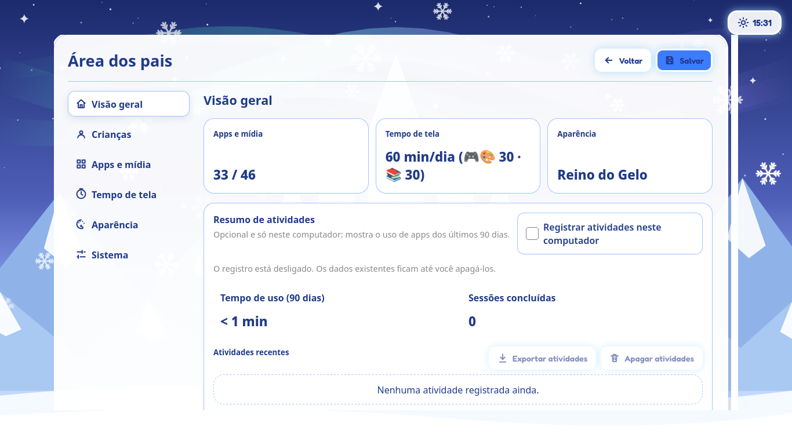
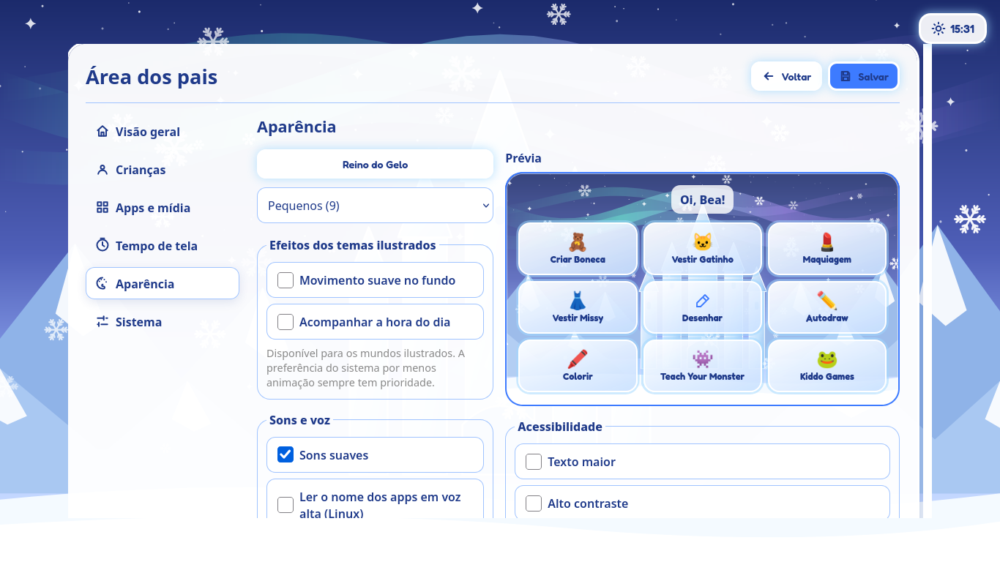

# Benikids

🇧🇷 [Português](README.md) · 🇺🇸 **English**

**A computer for kids that balances learning and play, on Windows and Linux.**

Benikids is a full-screen menu for children aged 5 to 10. Kids only see what their parents approved,
screen time is split by category, and game time depends on having done the learning part first. It's
light enough to bring that old laptop forgotten in a drawer back to life.

> The app itself is in Brazilian Portuguese (the kids' screens and the parents' area).


## What's inside

- **📚 Learn · 🎨 Hobbies · 🎮 Play.** The child picks what to do, and each card shows how much time is left today.
- **⏳ Screen time per category**, different for each weekday if you like. In the last seconds a countdown warns the child, and Benikids closes the game itself when time runs out.
- **⭐ Required learning** (optional): if yesterday's learning was missing, today's game time is shorter.
- **🎲 Hand-picked free games and programs**: GCompris, Tux Paint, SuperTux, SuperTuxKart, Luanti, Scratch, Stellarium, Klavaro and more. Everything starts turned on, and parents turn off what they don't want.
- **🎮 Generic USB gamepads**, cheap unbranded ones included: a wizard sets them up button by button, and the same gamepad works in the menu and in games. Holding Start + Select closes the game and returns to the menu.
- **👧👦 One profile per child**, with their own themes (Spider Hero, Building Blocks, Ninja Dojo, Ice Kingdom, Magic House, Enchanted Castle). The parents' area is protected by a PIN.
- **⚡ Lightweight:** the menu is a native app drawn by the graphics card. On a 2011 laptop it opens in ~1 s and idles at ~1 % CPU.

**On Linux**, the whole computer becomes the kids' computer. It boots straight into the menu and adds:
- **internet filtering** on any Wi‑Fi, with SafeSearch and restricted YouTube;
- **automatic login** to Khan Academy and Teach Your Monster;
- **itch.io** games;
- **Super Nintendo** and **PlayStation**;
- **automatic updates**.

## Install

### Windows 10 and 11

1. Sign in to the **child's Windows account**. It doesn't need administrator rights.
2. Download [**Beni-Windows.zip**](https://nightly.link/jaison/benikids/workflows/menu-nativo/main/Beni-Windows.zip), unzip it and double-click **`Instalar Beni.cmd`**.
3. Accept installing the games and programs. A few of them ask **once** for the password of an administrator of the computer.
4. The first time it opens, enter each child's name and the **parents' PIN**.

From then on, Benikids opens by itself when the child signs in to Windows. You can turn this off in
the parents' area. **To update**, download the package again and run the installer. Settings and
screen time are kept.

### Linux (Mint XFCE)

1. Install **Linux Mint XFCE**, create the child's user and turn on **automatic login**.
2. In the child's account, open the Terminal and run:
   ```bash
   git clone https://github.com/jaison/benikids.git
   cd benikids
   ./instalar.sh
   ```
3. Log out and back in: the menu opens by itself. In **Pais → Sistema** (Parents → System), create the **parents' PIN**.

From then on, the laptop **updates itself**.

Want to fine-tune it (ROMs, Luanti, itch.io collections)? See [fine-tuning on Linux](docs/benikids-technical.md#fine-tuning-on-linux).

## Why this project exists

> I'm **Jaison**. I wanted to give new life to a 2011 laptop for my nephew **Benício** (Beni), and
> turn a machine that would sit unused into a computer he could use on his own, safely: a real
> keyboard and mouse, only programs and sites I had tested, filtered internet, time rules and no
> passwords to remember. Along the way it gained a profile for my 5-year-old niece **Bea**, with games
> and themes for her, and later a Windows version. It's all here, for anyone who wants to do the same.

## Gallery

Some of the settings parents can change in the **parents' area**, protected by the PIN:

| Overview | Appearance, with a preview |
|---|---|
|  |  |

## More details

[**docs/benikids-technical.md**](docs/benikids-technical.md) covers:
- each feature in detail: screen time, required learning, logins, internet, gamepads and updates;
- how it works inside;
- how to publish an update;
- the fixes for old hardware;
- the test machines;
- known limitations.

The native menu (Rust + [gpui-fast](https://github.com/longbridge/gpui-fast)) is described in
[cliente/LEIA-ME.md](cliente/LEIA-ME.md) (in Portuguese).

## Credits and license

- Started from **[Cozy Kids Launcher](https://github.com/TrissyGE/cozy-kids-launcher)** 0.6.0, © 2026 Tristan and contributors, **MIT license**.
  - The license still covers all the code ([LICENSE](LICENSE)), and this project's changes are published under the same license.
  - The original README is in [README.original.md](README.original.md).
- Theme fonts (Bangers, Bungee, Shojumaru, Fredoka): SIL Open Font License, see [themes/fonts/LEIA-ME.md](themes/fonts/LEIA-ME.md).
- uBlock Origin (GPLv3) © Raymond Hill, included unmodified.
- The apps, games and sites belong to their authors and are only downloaded or opened from their official sources.
- Made with help from Claude (Anthropic) via Claude Code.
