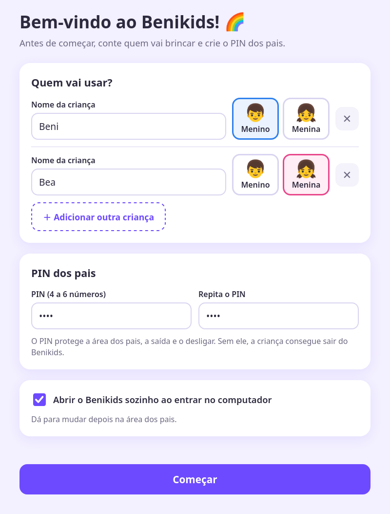
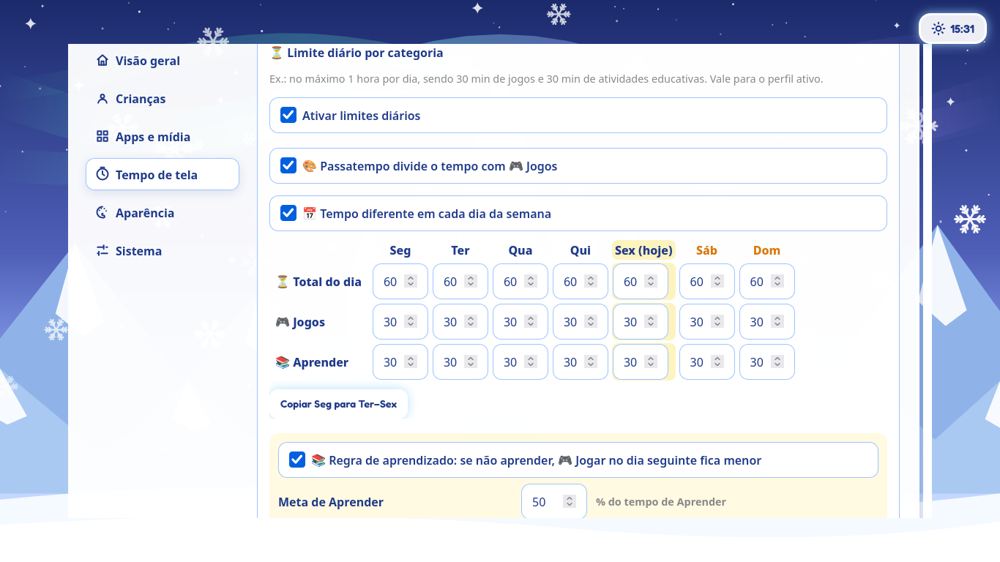
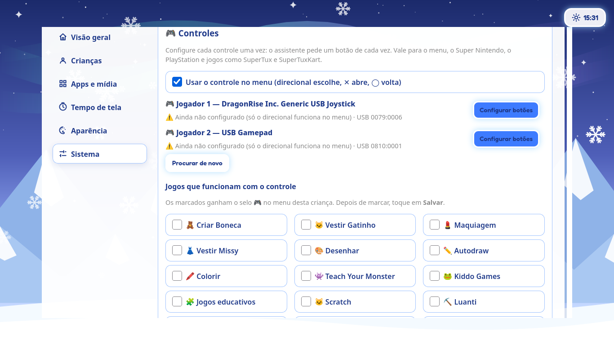
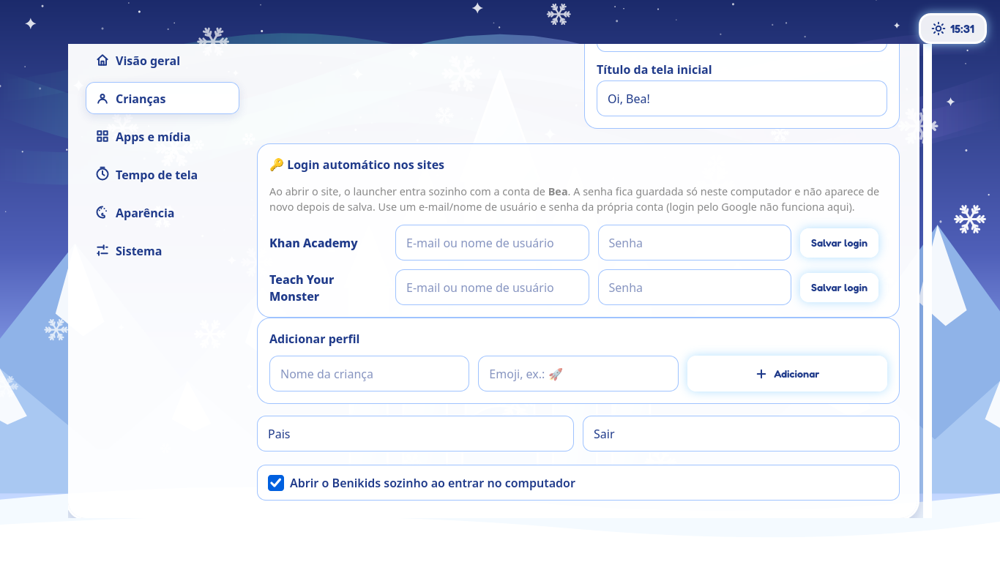
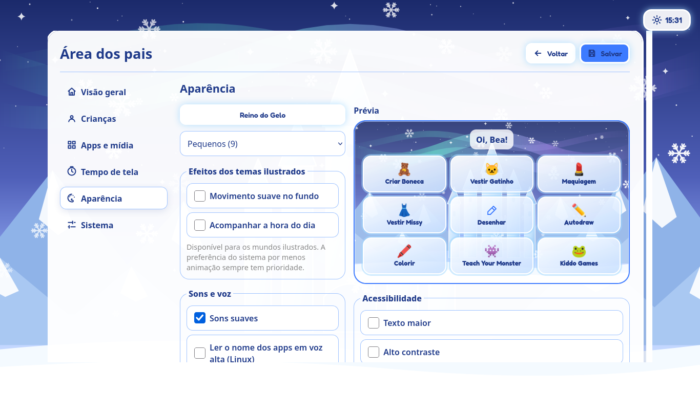

# Benikids

🇧🇷 **Português** · 🇺🇸 [English](README.en.md)

**Um computador para crianças que equilibra aprender e brincar, no Windows e no Linux.**

O Benikids é um menu em tela cheia para crianças de 5 a 10 anos. A criança só encontra o que os pais
aprovaram, o tempo de tela é separado por categoria, e o tempo de jogo depende de ela ter feito a parte
de aprender. É leve o bastante para dar vida nova àquele notebook antigo esquecido na gaveta.


## O que tem

- **📚 Aprender · 🎨 Passatempo · 🎮 Jogar.** A criança escolhe o que quer fazer, e cada cartão mostra quanto tempo ainda resta hoje.
- **⏳ Tempo de tela por categoria**, diferente em cada dia da semana se você quiser. Nos últimos segundos, uma contagem avisa a criança, e o próprio Benikids fecha o jogo no fim do tempo.
- **⭐ Reforço de aprendizagem** (opcional): se ontem faltou a parte de Aprender, hoje o tempo de jogo fica menor.
- **🎲 Jogos e programas livres já escolhidos**: GCompris, Tux Paint, SuperTux, SuperTuxKart, Luanti, Scratch, Planetário, Digitação e outros. Tudo vem ligado, e os pais desligam o que não quiserem.
- **🎮 Controles USB genéricos**, inclusive os baratos sem marca: um assistente configura botão por botão, e o mesmo controle serve no menu e nos jogos. Segurar Start + Select fecha o jogo e volta ao menu.
- **👧👦 Um perfil por criança**, com temas próprios (Herói Aranha, Blocos de Montar, Dojo Ninja, Reino do Gelo, Casinha Mágica, Castelo Encantado). A área dos pais fica protegida por PIN.
- **⚡ Leve:** o menu é um app nativo desenhado pela placa de vídeo. Num notebook de 2011, abre em ~1 s e fica parado em ~1% de CPU.
- **🇧🇷 Tudo em português do Brasil.**

**No Linux**, o computador inteiro vira o computador das crianças. Ele liga direto no menu e ganha
mais estes recursos:
- **filtro de internet** em qualquer Wi‑Fi, com Busca Segura e YouTube restrito;
- **login automático** no Khan Academy e no Teach Your Monster;
- jogos do **itch.io**;
- **Super Nintendo** e **PlayStation**;
- **atualização automática**.

## Instalar

### Windows 10 e 11

1. Entre no **usuário do Windows da criança**. Ele não precisa ser administrador.
2. Baixe o [**Beni-Windows.zip**](https://nightly.link/jaison/benikids/workflows/menu-nativo/main/Beni-Windows.zip), descompacte e dê dois cliques em **`Instalar Benikids.cmd`**.
3. Aceite instalar os jogos e programas. Alguns pedem **uma vez** a senha de um administrador do computador.
4. Na primeira abertura, cadastre o nome de cada criança e o **PIN dos pais**.

O Benikids passa a abrir sozinho quando a criança entra no Windows. Isso pode ser desligado em Pais.
**Para atualizar**, baixe o pacote de novo e rode o instalador. A configuração e o tempo de tela
continuam como estavam.

### Linux (Mint XFCE)

1. Instale o **Linux Mint XFCE**, crie o usuário da criança e ative o **login automático**.
2. No usuário da criança, abra o Terminal e rode:
   ```bash
   git clone https://github.com/jaison/benikids.git
   cd benikids
   ./instalar.sh
   ```
3. Saia e entre de novo: o menu abre sozinho. Em **Pais → Sistema**, crie o **PIN dos pais**.

A partir daí, o notebook **se atualiza sozinho**.

Quer ajustar mais (ROMs, Luanti, coleções do itch.io)? Veja os [ajustes finos no Linux](docs/benikids-tecnico.md#ajustes-finos-no-linux).

## Por que este projeto existe

> Eu sou o **Jaison**. Eu queria dar vida nova a um notebook de 2011 para o meu sobrinho **Benício**
> (o Beni), e transformar uma máquina que ia ficar parada num computador que ele pudesse usar sozinho,
> com segurança: teclado e mouse de verdade, só programas e sites testados por mim, internet com filtro,
> regras de tempo e nada de senha para decorar. No caminho, ganhou o perfil da minha sobrinha **Bea**,
> de 5 anos, com jogos e temas para ela, e depois uma versão para Windows. Está tudo aqui, para quem
> quiser fazer o mesmo.

## Galeria

O que os pais configuram, na **área dos pais** protegida pelo PIN:

| Configuração inicial | Tempo de tela |
|---|---|
|  |  |
| **Controles** | **Crianças e logins automáticos** |
|  |  |
| **Aparência, com prévia** | |
|  | |

## Mais detalhes

Em [**docs/benikids-tecnico.md**](docs/benikids-tecnico.md):
- cada recurso em detalhe: tempo de tela, reforço, logins, internet, controles e atualizações;
- como funciona por dentro;
- como publicar uma atualização;
- as correções para hardware antigo;
- os ambientes de teste;
- as limitações conhecidas.

O menu nativo (Rust + [gpui-fast](https://github.com/longbridge/gpui-fast)) está em
[cliente/LEIA-ME.md](cliente/LEIA-ME.md).

## Créditos e licença

- Nasceu do **[Cozy Kids Launcher](https://github.com/TrissyGE/cozy-kids-launcher)** 0.6.0, © 2026 Tristan e colaboradores, **licença MIT**.
  - A licença continua valendo para todo o código ([LICENSE](LICENSE)), e as mudanças deste projeto saem sob a mesma licença.
  - O README original está em [README.original.md](README.original.md).
- Fontes dos temas (Bangers, Bungee, Shojumaru, Fredoka): SIL Open Font License, veja [themes/fonts/LEIA-ME.md](themes/fonts/LEIA-ME.md).
- uBlock Origin (GPLv3) © Raymond Hill, incluído sem modificações.
- Os apps, jogos e sites pertencem aos seus autores e só são baixados ou abertos das fontes oficiais.
- Feito com a ajuda do Claude (Anthropic) via Claude Code.
